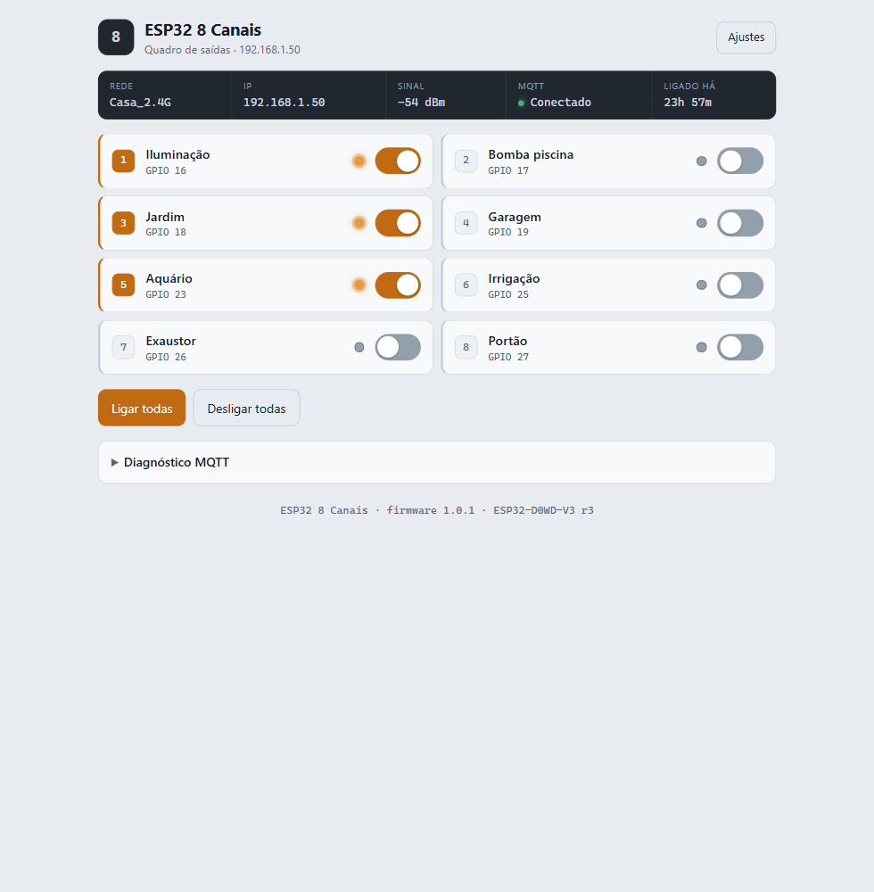
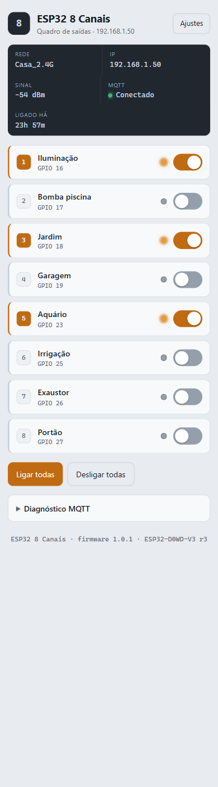

<div align="center">

# ESP32 · 8 Saídas (Relés)

### Painel web + MQTT com auto-descoberta no Home Assistant + Portal cativo

[](https://github.com/mpsc/ESP32_8CH_Relay_HA/actions/workflows/compile.yml)
[](CHANGELOG.md)
[](LICENSE)
[](docs/HARDWARE.md)

Firmware para **ESP32** que controla **8 relés (somente saídas)** com uma
interface web moderna, pronta para o **Home Assistant** e configurável 100%
pelo navegador.



</div>

---

## Índice

- [Recursos](#recursos)
- [Hardware e pinagem](#hardware-e-pinagem)
- [Instalação](#instalação)
- [Primeira configuração (portal cativo)](#primeira-configuração-portal-cativo)
- [Painel de controle](#painel-de-controle)
- [MQTT e Home Assistant](#mqtt-e-home-assistant)
- [API HTTP](#api-http)
- [Estrutura do projeto](#estrutura-do-projeto)
- [Compilação (CI)](#compilação-ci)
- [Solução de problemas](#solução-de-problemas)
- [Documentação](#documentação)
- [Contribuindo](#contribuindo)
- [Licença](#licença)

## Recursos

- 🔌 **8 saídas digitais** (relés) — acionamento individual ou todas de uma vez.
- 🌐 **Painel web responsivo**, com tema **claro/escuro automático** — funciona
  em celular e computador, sem app.
- 🏠 **MQTT com auto-descoberta no Home Assistant** — as 8 saídas e os sensores
  aparecem sozinhos (sem editar `configuration.yaml`).
- 📡 **Portal cativo** — na primeira ligação, cria a rede `ESP32-8CH-XXXX` e
  abre a página de configuração automaticamente.
- ⚙️ **Configuração pela web** salva em NVS: Wi-Fi, MQTT, nomes das saídas,
  polaridade dos relés e restauração de estado.
- 🔗 **mDNS** — acesso por `http://<id>.local`.
- 🧰 **API HTTP em JSON** para scripts e integrações.
- 🩺 Telemetria no HA: sinal Wi-Fi, tempo ligado e endereço IP, além de um
  botão de reiniciar.

## Hardware e pinagem

| Item | Valor |
|---|---|
| Placa | **ESP32-D0WD-V3** (ESP32 clássico), 4 MB de flash |
| Conexão USB | CP2102 (ou CH340) |
| Saídas | **GPIO 16, 17, 18, 19, 23, 25, 26, 27** |

| Saída | 1 | 2 | 3 | 4 | 5 | 6 | 7 | 8 |
|---|:--:|:--:|:--:|:--:|:--:|:--:|:--:|:--:|
| GPIO | 16 | 17 | 18 | 19 | 23 | 25 | 26 | 27 |

> Detalhes de ligação, alimentação, polaridade e **segurança elétrica** em
> [docs/HARDWARE.md](docs/HARDWARE.md). ⚠️ Relés podem comutar 110/220 V.

## Instalação

Precisa de: **Arduino IDE 2.x** (ou `arduino-cli`), core **esp32:esp32**
(teste em 2.0.17) e as bibliotecas **PubSubClient** e **ArduinoJson 7.x**.

```bash
arduino-cli core install esp32:esp32@2.0.17
arduino-cli lib install PubSubClient
arduino-cli lib install ArduinoJson   # 7.x

# A pasta do sketch deve ter o mesmo nome do .ino (veja INSTALACAO.md)
arduino-cli compile --fqbn esp32:esp32:esp32 ESP32_8CH_Relay_HA
arduino-cli upload  -p COM3 --fqbn esp32:esp32:esp32 ESP32_8CH_Relay_HA
```

Passo a passo completo (IDE e CLI, além de problemas comuns de gravação) em
**[docs/INSTALACAO.md](docs/INSTALACAO.md)**.

## Primeira configuração (portal cativo)

1. Conecte-se à rede **`ESP32-8CH-XXXX`** (senha **`12345678`**).
2. A página de configuração abre sozinha — ou acesse **http://192.168.4.1**.
3. Escolha a rede Wi-Fi, informe o MQTT (IP do Home Assistant) e **Salvar**.
4. Acesse o dispositivo em **`http://esp32_8ch_XXXXXX.local`** (ou pelo IP).

## Painel de controle

<div align="center">

</div>

- **Barra de status:** rede, IP, sinal Wi-Fi, MQTT e tempo ligado.
- **Canais:** nome, GPIO, LED indicador e interruptor por saída.
- **Ligar/Desligar todas:** comandos gerais.
- **Diagnóstico MQTT:** broker, tópicos por canal e teste sugerido.

Passo a passo de **todas as funções** em **[docs/MANUAL.md](docs/MANUAL.md)**.

## MQTT e Home Assistant

Configure o mesmo broker no firmware e na integração **MQTT** do Home Assistant.
As entidades são criadas automaticamente:

| Entidade | Tipo |
|---|---|
| Saída 1…8 | `switch` |
| Sinal Wi-Fi | `sensor` (signal_strength) |
| Tempo ligado | `sensor` (duration) |
| Endereço IP | `sensor` (diagnostic) |
| Reiniciar | `button` |

Tópicos base: `esp32/<device_id>`. Tabela completa, exemplos de teste e cartão
Lovelace em **[docs/MQTT_HOME_ASSISTANT.md](docs/MQTT_HOME_ASSISTANT.md)**.

## API HTTP

| Endpoint | Descrição |
|---|---|
| `GET /api/state` | Estado completo (JSON) |
| `GET /api/out?ch=N&state=ON\|OFF\|TOGGLE` | Aciona uma saída |
| `GET /api/all?state=ON\|OFF` | Aciona todas |
| `GET /api/mqtt` | Informações e tópicos MQTT |
| `GET /api/scan[?rescan=1]` | Varredura de redes Wi-Fi |
| `GET /api/discovery` | Reenvia a auto-descoberta |
| `GET /api/restart` | Reinicia o dispositivo |

Referência completa com exemplos em **[docs/API.md](docs/API.md)**.

## Estrutura do projeto

```
ESP32_8CH_Relay_HA.ino   firmware (Wi-Fi, MQTT/HA, web, portal cativo)
web_ui.h                 interface web (HTML/CSS/JS em PROGMEM)
docs/                    manual, API, MQTT, hardware, instalação
.github/                 CI (compilação) e templates de issue/PR
CHANGELOG.md             histórico de versões
```

## Compilação (CI)

O workflow [`.github/workflows/compile.yml`](.github/workflows/compile.yml)
compila o sketch a cada *push*/PR usando `arduino-cli` com o core `esp32:esp32`.

## Solução de problemas

| Problema | Solução |
|---|---|
| Relés ligam "ao contrário" | Marque **"Relé ativo em nível baixo (invertido)"** em `/config` |
| "Ligar todas" não responde | Atualize para a **v1.0.1** e recarregue com `Ctrl+F5` |
| `main file missing from sketch` | A pasta precisa ter o mesmo nome do `.ino` ([INSTALACAO.md](docs/INSTALACAO.md)) |
| Não abre em `*.local` | Use o IP; mDNS pode não resolver em toda rede |
| HA mostra "offline" | Confira IP/usuário/senha do broker (o motivo aparece no painel) |
| Falha ao gravar ("Timed out") | Segure **BOOT** ao iniciar a gravação; confira o cabo/porta |

Mais respostas na seção **Perguntas frequentes** do
[docs/MANUAL.md](docs/MANUAL.md#9-perguntas-frequentes).

## Documentação

| Documento | Conteúdo |
|---|---|
| [docs/MANUAL.md](docs/MANUAL.md) | Manual de utilização — todas as funções |
| [docs/INSTALACAO.md](docs/INSTALACAO.md) | Compilar e gravar (IDE/CLI) |
| [docs/HARDWARE.md](docs/HARDWARE.md) | Pinagem, ligação e segurança |
| [docs/MQTT_HOME_ASSISTANT.md](docs/MQTT_HOME_ASSISTANT.md) | Tópicos e integração com o HA |
| [docs/API.md](docs/API.md) | Referência da API HTTP |
| [docs/LICENCAS.md](docs/LICENCAS.md) | Licenças e créditos de terceiros |
| [CHANGELOG.md](CHANGELOG.md) | Histórico de versões |
| [SECURITY.md](SECURITY.md) | Boas práticas de segurança |

## Contribuindo

Sugestões e correções são bem-vindas! Veja
[CONTRIBUTING.md](CONTRIBUTING.md). Este projeto segue o
[Código de Conduta](CODE_OF_CONDUCT.md).

## Licença

Distribuído sob a licença **[MIT](LICENSE)**.

Este é um projeto **independente**, sem vínculo ou endosso da Espressif, do
Arduino ou do Home Assistant — essas marcas pertencem aos seus titulares e são
citadas apenas de forma descritiva. Créditos de bibliotecas e marcas de
terceiros em **[docs/LICENCAS.md](docs/LICENCAS.md)**.

---

<div align="center">

Feito por **Marcos (mpsc)** · ⭐ se este projeto foi útil para você

</div>
