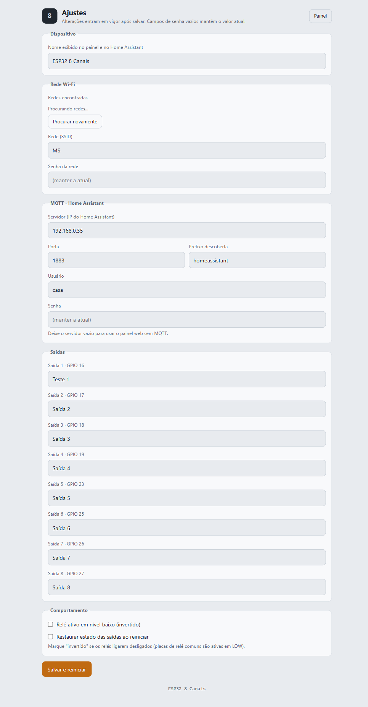

# Manual de utilização

Guia completo de uso do **ESP32 · 8 Saídas (Relés)**. Aqui você encontra a
descrição de **todas as funções** — do primeiro acesso ao controle pelo Home
Assistant.

- [1. Visão geral](#1-visão-geral)
- [2. Primeiro acesso (portal cativo)](#2-primeiro-acesso-portal-cativo)
- [3. O painel de controle](#3-o-painel-de-controle)
- [4. Página de configuração](#4-página-de-configuração)
- [5. Comportamento no boot e segurança](#5-comportamento-no-boot-e-segurança)
- [6. Controle pelo Home Assistant](#6-controle-pelo-home-assistant)
- [7. Controle por outros sistemas](#7-controle-por-outros-sistemas)
- [8. Reiniciar e atualizar o firmware](#8-reiniciar-e-atualizar-o-firmware)
- [9. Perguntas frequentes](#9-perguntas-frequentes)
- [10. Referência rápida das funções](#10-referência-rápida-das-funções)

---

## 1. Visão geral

O dispositivo controla **8 relés (somente saídas)** por três caminhos:

| Caminho | Como | Melhor para |
|---|---|---|
| **Painel web** | Navegador em `http://<id>.local` ou pelo IP | Uso manual rápido no dia a dia |
| **MQTT / Home Assistant** | Auto-descoberta — os `switch` aparecem sozinhos | Automações, rotinas, integração |
| **API HTTP** | Requisições JSON | Scripts e integrações próprias |

Não há controle local por botão físico: o acionamento é sempre remoto.

## 2. Primeiro acesso (portal cativo)

Na primeira vez (ou sem rede Wi-Fi salva), o dispositivo cria a própria rede:

1. No celular/PC, abra a lista de redes Wi-Fi e conecte em **`ESP32-8CH-XXXX`**.
   A senha é **`12345678`**.
2. A **página de configuração abre sozinha** (portal cativo). Se não abrir,
   acesse **http://192.168.4.1** no navegador.
3. Preencha a rede Wi-Fi e o MQTT (opcional) e clique em **Salvar e reiniciar**.
4. O dispositivo reinicia, conecta à sua rede e passa a responder em
   **`http://esp32_8ch_XXXXXX.local`** (o IP aparece no roteador e no HA).

> Enquanto estiver no modo portal (AP), o dispositivo **reinicia após 5 minutos**
> sem nenhum cliente conectado, para tentar reconectar ao Wi-Fi salvo. Se ainda
> não houver Wi-Fi salvo, ele permanece em modo AP.

## 3. O painel de controle

A tela principal (`/`) é dividida em quatro áreas:


```
┌──────────────────────────────────────────────┐
│  [8]  Nome do dispositivo        [ Ajustes ] │  ← cabeçalho
├──────────────────────────────────────────────┤
│ REDE | IP | SINAL | MQTT | LIGADO HÁ         │  ← barra de status
├──────────────────────────────────────────────┤
│ 1  Teste 1          GPIO 16   ●  (  )        │  ← canais (saídas)
│ 2  Saída 2          GPIO 17   ○  (  )        │
│ ...                                          │
├──────────────────────────────────────────────┤
│ [ Ligar todas ]  [ Desligar todas ]          │  ← comandos gerais
├──────────────────────────────────────────────┤
│ ▸ Diagnóstico MQTT                           │  ← (expansível)
└──────────────────────────────────────────────┘
```

### 3.1 Barra de status

| Campo | O que mostra |
|---|---|
| **REDE** | Nome da rede Wi-Fi conectada (ou "(modo configuração)" no AP) |
| **IP** | Endereço IP atual do dispositivo |
| **SINAL** | Intensidade do Wi-Fi em dBm (quanto mais perto de 0, melhor) |
| **MQTT** | `Conectado` (ponto verde) ou o motivo da falha (ponto vermelho) |
| **LIGADO HÁ** | Tempo desde o último boot (ex.: `1d 2h 3m`) |

A barra se atualiza sozinha a cada **3 segundos**.

### 3.2 Canais (saídas)

Cada linha é uma saída:

- **Número** — posição da saída (1 a 8), corresponde à ordem dos GPIOs.
- **Nome** — o nome que você definiu na configuração.
- **GPIO** — o pino físico acionado.
- **LED indicador** — fica **âmbar/avermelhado e brilhante** quando a saída
  está ligada.
- **Interruptor (rocker)** — clique para **alternar**. As transições são
  otimistas (o visual muda na hora e o estado é confirmado no servidor).

### 3.3 Ligar / Desligar todas

- **Ligar todas** — liga as 8 saídas de uma só vez.
- **Desligar todas** — desliga as 8 saídas de uma só vez.

### 3.4 Diagnóstico MQTT

Clique para expandir. Mostra o **broker**, **usuário**, **Client ID**, **prefixo
de descoberta** e a **memória livre**. Em seguida, lista por canal o **tópico de
estado** e o **tópico de comando**, além de um exemplo de teste com
`mosquitto_pub`.

### 3.5 Ajustes

O botão **Ajustes** (canto superior direito) abre a página de configuração.

## 4. Página de configuração

Acessível em `/config` (ou automaticamente no modo portal).



### 4.1 Dispositivo

- **Nome exibido no painel e no Home Assistant** — até 40 caracteres. Este é o
  nome do dispositivo no HA e o título do painel.

### 4.2 Rede Wi-Fi

- **Redes encontradas** — lista as redes detectadas (com cadeado de "protegida"
  e o sinal em dBm). Clique em uma rede para preencher o SSID.
- **Procurar novamente** — dispara uma nova varredura.
- **Rede (SSID)** — o nome da rede de destino.
- **Senha da rede** — deixe **vazio** para manter a senha já salva.

### 4.3 MQTT · Home Assistant

- **Servidor** — IP do broker (ex.: o IP do Home Assistant). **Deixe vazio para
  usar o painel web sem MQTT.**
- **Porta** — padrão `1883`.
- **Prefixo descoberta** — tópico-raiz da auto-descoberta (padrão
  `homeassistant`).
- **Usuário** / **Senha** — credenciais do broker. A senha vazia mantém a atual.

### 4.4 Saídas

Um campo de nome para cada uma das 8 saídas (até 30 caracteres cada). O rótulo
mostra o GPIO correspondente. Esses nomes viram os nomes das entidades no HA.

### 4.5 Comportamento

- **Relé ativo em nível baixo (invertido)** — marque se os relés ligarem
  "ao contrário" (comum em módulos ativos em LOW).
- **Restaurar estado das saídas ao reiniciar** — se marcado, ao ligar o
  dispositivo as saídas voltam ao estado que tinham antes do último desligamento.
  Se desmarcado, todas iniciam **desligadas**.

### 4.6 Salvar

**Salvar e reiniciar** grava tudo na memória não volátil (NVS) e reinicia o
dispositivo. A confirmação mostra o endereço `http://<id>.local`.

## 5. Comportamento no boot e segurança

- **Sem Wi-Fi salvo:** sobe em modo portal cativo.
- **Wi-Fi salvo e acessível:** conecta e publica a disponibilidade `online`.
- **Wi-Fi salvo mas inacessível:** fica por 20 s tentando; se falhar, abre o
  portal cativo (com retry a cada 5 min).
- **Estado das saídas:** segue a opção "Restaurar estado" (ver 4.5).
- **Reconexão MQTT:** automática, com nova tentativa a cada 5 s.

> A interface web **não tem senha**. Qualquer pessoa na mesma rede pode
> controlar as saídas. Veja as boas práticas em [SECURITY.md](../SECURITY.md).

## 6. Controle pelo Home Assistant

Com o MQTT configurado, as entidades aparecem automaticamente. Detalhes
completos (tópicos, testes, cartão de exemplo) em
**[MQTT e Home Assistant](MQTT_HOME_ASSISTANT.md)**.

Resumo:

- 8 **switches** (um por saída) — ligam/desligam pelo HA.
- Sensores de diagnóstico: **sinal Wi-Fi**, **tempo ligado**, **endereço IP**.
- Botão **Reiniciar**.
- Disponibilidade `online`/`offline` (LWT).

## 7. Controle por outros sistemas

- **MQTT:** publique `ON`/`OFF` em `esp32/<id>/out<N>/set`.
- **API HTTP:** veja **[API](API.md)** (ex.: ligar todas com
  `GET /api/all?state=ON`).

## 8. Reiniciar e atualizar o firmware

- **Reiniciar pelo painel/HA:** use o botão de reiniciar (no HA) ou o endpoint
  `GET /api/restart`.
- **Atualizar o firmware:** não há OTA. Regrave via USB seguindo
  [INSTALACAO.md](INSTALACAO.md). A configuração é preservada na NVS entre
  gravações.

## 9. Perguntas frequentes

<details>
<summary>Os relés ligam quando o painel mostra "desligado".</summary>

Ative a opção **"Relé ativo em nível baixo (invertido)"** na configuração.
</details>

<details>
<summary>"Ligar todas" não faz nada.</summary>

Corrigido a partir da versão **1.0.1** (era um conflito de nome com
`document.all`). Se ainda ocorrer, recarregue a página com `Ctrl+F5` para
descartar o JavaScript antigo em cache.
</details>

<details>
<summary>Não consigo abrir o painel.</summary>

Teste primeiro pelo IP (ex.: `http://192.168.0.102`). O endereço `.local`
depende de mDNS, que nem toda rede resolve. Confira também se o celular/PC está
na mesma rede.
</details>

<details>
<summary>O dispositivo aparece "offline" no Home Assistant.</summary>

Verifique usuário/senha e o IP do broker. O motivo da falha aparece no painel,
na célula **MQTT**, e a lógica de reconexão roda a cada 5 s.
</details>

<details>
<summary>Troquei de rede Wi-Fi e agora não acho o dispositivo.</summary>

Ele pode ter subido em modo portal cativo. Procure a rede `ESP32-8CH-XXXX` e
reconfigure.
</details>

<details>
<summary>Os nomes das saídas não mudaram no Home Assistant.</summary>

Renomeie na configuração e, se necessário, force a descoberta com
`GET /api/discovery`. Entidades antigas podem ficar órfãs — remova-as na
integração MQTT do HA.
</details>

## 10. Referência rápida das funções

| Função | Onde | Como |
|---|---|---|
| Ligar/desligar uma saída | Painel web | Clique no interruptor da linha |
| Ligar todas | Painel web | Botão **Ligar todas** |
| Desligar todas | Painel web | Botão **Desligar todas** |
| Ver estado/telemetria | Painel web | Barra de status e *Diagnóstico MQTT* |
| Renomear saídas | `/config` → Saídas | Editar os campos e salvar |
| Trocar de rede Wi-Fi | `/config` → Rede Wi-Fi | Selecionar a rede, digitar a senha, salvar |
| Configurar MQTT | `/config` → MQTT | Informar servidor/porta/usuário/senha e salvar |
| Inverter lógica dos relés | `/config` → Comportamento | Marcar "invertido" |
| Restaurar estado no boot | `/config` → Comportamento | Marcar "restaurar estado" |
| Reenviar descoberta ao HA | Painel web / API | `GET /api/discovery` |
| Reiniciar | HA / API | Botão "Reiniciar" / `GET /api/restart` |
| Ligar todas (integração) | API HTTP | `GET /api/all?state=ON` |
| Controlar por MQTT | Broker | Publicar `ON`/`OFF` em `.../out<N>/set` |
| Ver/alternar por script | API HTTP | `GET /api/out?ch=N&state=TOGGLE` |
